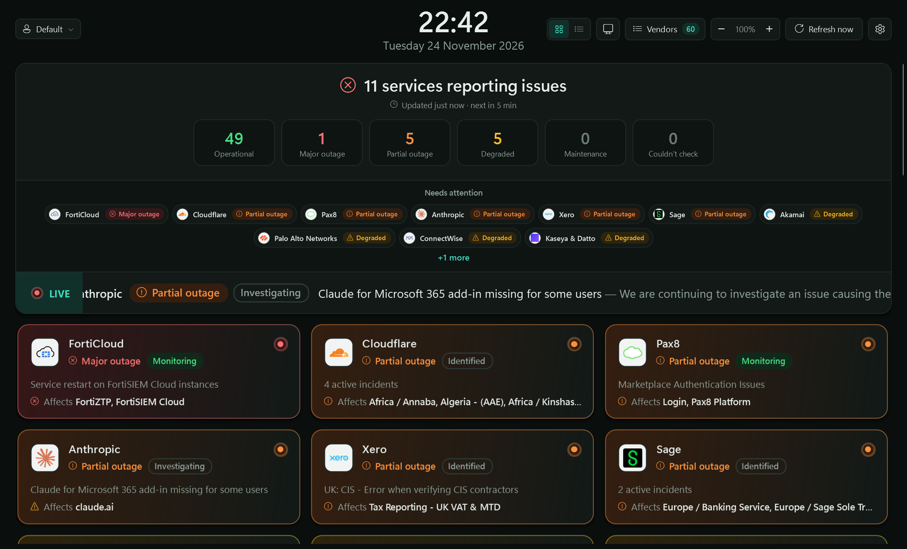
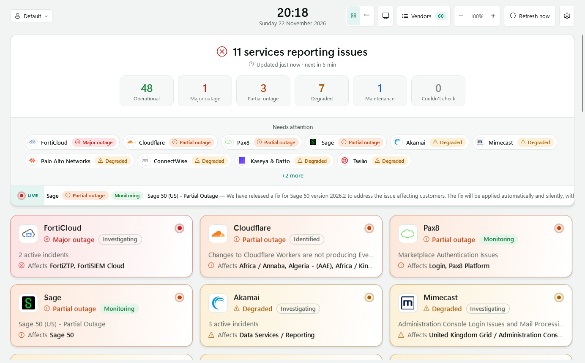
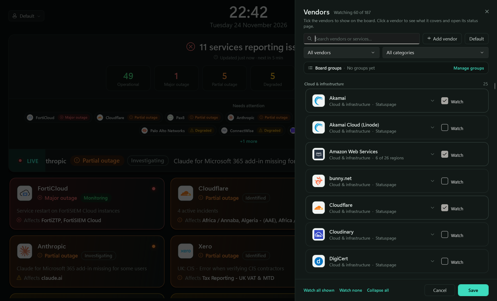

# Status Board

[](../../releases/latest)


[](LICENSE)

A small, portable Windows dashboard showing the public status of the cloud, SaaS and everyday services you depend on, plus
your own websites, hosts and (optionally) LibreNMS. Status comes only from each vendor's **public** status page or feed:
no vendor accounts, no sign-in, no telemetry and no data about you sent anywhere.



**[Download the latest release](../../releases/latest)**: unzip, run `StatusBoard.exe`. Nothing to install.

## Contents

- [Features](#features) · [Screenshots](#screenshots) · [Running it](#running-it) ·
  [Privacy, security and network use](#privacy-security-and-network-use) · [Building](#building) ·
  [Project layout](#project-layout) · [Licence](#licence)

## Features

- **Status bar:** a headline ("3 services reporting issues"), when it last and next refreshes, counters for Operational ·
  Major outage · Partial outage · Degraded · Maintenance · Couldn't check, and a **Needs attention** row of clickable chips.
- **News ticker** (optional): a LIVE strip scrolling the latest update of each active incident. Hover or Tab into it to
  pause; click an item to open that vendor.
- **Tiles or list:** problems first, worst first. Healthy tiles stay quiet; problems get a tint, a coloured edge and a
  pulsing dot. Resize with − / % / + in the header, **Ctrl + mouse wheel**, **Ctrl +/−** and **Ctrl 0**.
- **Details panel:** incidents with their stage (Investigating, Monitoring…), affected components and a link to the
  official page. Drag its edge to resize. **Esc** closes it.
- **187 built-in services** (Microsoft 365, Azure, AWS, Google, Cloudflare, Slack, Zoom, Atlassian, Salesforce, Stripe…).
  **Vendors** (top right) picks what to watch, narrows a vendor to the products, regions or components you use, and
  arranges vendors into **groups** shown as sections at the top of the board.
- **Add your own:** any status page or RSS/Atom feed (paste its link), **website checks** (expected HTTP codes, slow
  threshold), **ping checks**, and **LibreNMS** alerts. Checks run every minute and only alert after several failures in
  a row.
- **Profiles:** each profile is its own board (vendors, groups, theme). Switch from the top-left corner. A first-run
  setup creates the first one.
- **TV mode** (**F11**, or start with `--tv`): full screen, larger tiles, slow auto-scroll that keeps the counters and
  ticker pinned to the top, pauses at the top and bottom, and hides the buttons and pointer when the mouse is idle.
  **Esc** leaves.
- **Themes:** follow Windows, Light, Dark, AMOLED (true black) or Hacker (green terminal). The title bar matches.
- **Custom logos:** upload any PNG/JPG; it's trimmed and centred to match the built-in ones.
- **Tray icon** coloured by overall status, and optional **notifications** when a status changes. Starting the exe again
  brings the running window forward.

## Screenshots

| Light theme | Choosing vendors |
| --- | --- |
|  |  |

## Running it

Download `StatusBoard-v1.1-win-x64.zip` from the release, unzip it anywhere (a USB stick is fine) and run
`StatusBoard.exe`. It's self-contained: no installer and no .NET download. Requires 64-bit Windows 10 or 11.

Everything is stored next to the exe: `profiles.json` and one settings file per profile (`statusboard.json`,
`profile-*.json`), plus `logos\` (cached and uploaded logos). Nothing is written to AppData, Temp or the registry
(`tools\check-footprint.ps1` verifies this). To uninstall, delete the folder.

## Privacy, security and network use

- **Read-only, outbound GET requests** to the status pages you've chosen (and to vendor websites once, for logos), plus
  any website, ping or LibreNMS checks you add yourself. No
  listening ports, no inbound connections, no auto-update, no analytics. The User-Agent is simply `StatusBoard/1.1`.
- **Gentle on the network:** refreshes every 5 minutes by default (1–60 or manual), at most 12 sources at once and 4
  connections per host; idle connections close after a minute. Requests time out after 15 s with up to 3 attempts.
  Your own website/ping checks run every minute, only if you add some. Uses the Windows proxy settings.
- **Certificates are always validated**, except for a source where you explicitly allow a self-signed certificate (for
  an internal LibreNMS or website). Requests carrying a token never follow redirects, so a token can't be passed on to
  another host.
- **LibreNMS tokens** are encrypted with Windows DPAPI for your Windows user and never leave your PC except to your
  LibreNMS server.
- **Untrusted content is handled defensively:** responses are size-capped, XML is parsed with DTDs and external entities
  disabled, logos are size-checked before decoding, and only `http`/`https` links are ever opened.
- Runs as a normal user (`asInvoker`); needs no administrator rights.

## Building

Windows 10/11 and the .NET 10 SDK (`winget install Microsoft.DotNet.SDK.10`).

```powershell
.\build.ps1                          # tests, then artifacts\StatusBoard\ + artifacts\StatusBoard-v1.1-win-x64.zip (+ .sha256)
.\build.ps1 -FrameworkDependent      # ~2 MB exe; needs the .NET 10 Desktop Runtime on the PC
.\build.ps1 -SingleExe               # one file; .NET extracts 5 native DLLs to %TEMP%\.net on first run
.\build.ps1 -Compact                 # compressed exe: half the disk space, ~70 MB more RAM while running
dotnet test tests/StatusBoard.Tests  # unit tests only (saved responses, no network)
```

Opt-in live check of every built-in source: `$env:STATUSBOARD_LIVE='1'; dotnet test tests/StatusBoard.Tests`.

**UI self-test:** drives the real window through every flow (details panel, splitter, narrow/wide, settings, themes,
profiles, setup, tray, vendors, checks, groups, tile sizes, TV mode, scripted outages through the ticker, frame rate) and
writes `selftest.txt` plus screenshots. It changes the settings files, so run it on a copy:

```powershell
Copy-Item artifacts\StatusBoard $env:TEMP\sb -Recurse; & $env:TEMP\sb\StatusBoard.exe --selftest $env:TEMP\sb\results
```

Render to a PNG without showing a window: `StatusBoard.exe --snapshot out.png --size 1200x800 --theme Dark --select github`.

## Project layout

```
src/StatusBoard.Core/   no UI, no packages
  Models.cs             statuses, incidents, results
  Config.cs             settings files, categories, DPAPI secrets
  Profiles.cs           profiles.json and one settings file per profile
  DefaultVendors.cs     the built-in catalogue (one line per vendor)
  Http.cs               fetcher: timeouts, retries, redirect and size limits, BOM/charset decoding
  Json.cs               forgiving JSON accessors and HTML text cleanup
  Discovery.cs          "Add vendor" detection and logo finding
  StatusService.cs      throttled parallel refresh with per-source isolation; news ticker
  ComponentFilter.cs    narrowing a vendor to chosen components
  Providers/            one adapter per kind of status source, plus website/ping checks
src/StatusBoard/        WPF app
  App.xaml(.cs)         startup, single instance, tray wiring
  MainWindow            header, board, details panel, TV mode
  Views/                StatusBar (+ ticker), Details, Settings, Setup, Vendors, small controls
  ViewModels/           Main, Card, Settings, Setup, Vendors, AddVendor
  Services/             Theme, Tray (direct Win32), Logos, logo import, SelfTest, Snapshot
  Themes/               Light, Dark, AMOLED, Hacker colours; Styles; item Templates
tests/StatusBoard.Tests/ xUnit + Samples/ (captured public responses and synthetic cases)
tools/                  check-footprint.ps1: proves nothing is written outside the app folder
```

## Adding a source type

Derive from `SimpleProvider` (one GET): set `Type`, optionally `UrlFor`, and implement `Read` by calling a static
`Parse(...)` you can test against a saved sample. Register it in `ProviderRegistry.CreateDefault()`.
`LibreNmsProvider` shows an authenticated multi-request API (headers, tokens, per-source certificates via `FetchOptions`).

## Licence

Copyright (c) 2026 iamadamam. Licensed under the [PolyForm Strict License 1.0.0](LICENSE): free for noncommercial and
personal use; redistribution, modification and commercial use are not permitted without separate permission. Vendor names and logos belong to their owners; status data comes from their public pages.
Security issues: see [`SECURITY.md`](SECURITY.md).

---

<sub>Note: the LibreNMS integration is covered by automated tests but hasn't yet been tested by a person against a live
LibreNMS server.</sub>
